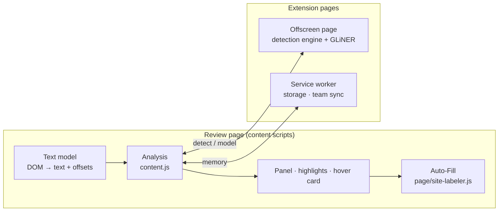

# Peak Talent PII Review Automation

Chrome extension that automates PII annotation review on Peak Talent.

**PII Review Automation** runs inside a Peak Talent review task. It reads the original document (left) and the scrubbed document (right), finds the personal, business and credential data in the original, and then checks every value:

- **PII still visible:** the value was neither labeled nor replaced on the right.
- **Over-scrubbed:** something that isn't PII was replaced.
- **Mislabeled:** a value carries the wrong label.

It can apply the labels on the site for you through the site's own labeling popup. It never presses Submit.

Everything runs in the browser. Document text is never sent anywhere.

---

## Contents

- [Features](#features)
- [How it works](#how-it-works)
- [Installation](#installation)
- [Usage](#usage)
- [Label sets](#label-sets)
- [Privacy and safety](#privacy-and-safety)
- [Repository layout](#repository-layout)
- [Documentation](#documentation)
- [Development](#development)
- [Releases](#releases)

## Features

| Area | What it does |
|---|---|
| **Detection** | About 80 PII types from rule-based detectors: names, emails, phone numbers, addresses, dates of birth, bank and card data, Indian/US/Brazilian/Indonesian government IDs, API keys and tokens, IPs, cloud and payment IDs. Each has validation such as checksums, keyword context and field names. |
| **On-device model** (optional) | A GLiNER multi-PII model (ONNX, run with onnxruntime-web in an offscreen page) adds names, companies, addresses and usernames that rules can't pin down. |
| **Label check** | Compares the labels on the right with what was detected on the left: missed PII, wrong label, labeled but not PII. |
| **Redaction check** | Aligns the two documents word by word. It classifies each change as correctly replaced, still visible, over-scrubbed, or replaced with a value of the wrong kind or unreadable filler. |
| **One review list** | Both checks merge into a single list grouped by label, with Prev / Next navigation, filters and per-group actions. |
| **Auto-Fill** | Labels everything that needs a label in one run (or one group at a time), through the site's own popup, one word per label. A hover card on any marked word applies its label with *Annotate matching entries* ticked. |
| **Highlights** | Colour underlines on both documents, drawn with the CSS Custom Highlight API. The page's DOM and text are never modified. |
| **Learning** | Remembers the reviewer's answers on the device ("Not PII", "this is a company") and applies them to the next document. Optional team sync shares only company names and plain "not PII" words. |
| **Select-to-check** | Select any text to see whether it is PII and why. |
| **Admin policy** | Organisation-wide settings through Chrome enterprise policy (`managed_schema.json`). |

## How it works



1. **Find the documents.** Saved setup, admin policy, `selectors.js`, or automatic detection of two side-by-side panels with mostly the same words.
2. **Detect.** Every detector runs over the left text in the offscreen page, or in the page as a fallback. Overlaps are resolved, and the model's entities are merged in.
3. **Compare.** The label check reads the site's labels on the right. The redaction check aligns the two texts and classifies every changed span.
4. **Decide.** Scrubbed values, date rules, link rules and the reviewer's remembered answers are applied. One list is built.
5. **Show and act.** The panel, highlights and hover cards appear, and Auto-Fill applies labels on request.

Full details are in [docs/ARCHITECTURE.md](docs/ARCHITECTURE.md).

## Installation

1. Clone or download this repository.
2. *(Optional)* Add the on-device model. See [models/README.md](models/README.md). Without it the extension runs on rules alone.
3. Open `chrome://extensions`, turn on **Developer mode**, click **Load unpacked**, and select the repository folder.
4. Open a review task on `*.peaktalent.ai` or `*.peaktalent.co`.

Requires Chrome 105 or later (Manifest V3, CSS Custom Highlight API, offscreen documents).

## Usage

| Action | How |
|---|---|
| Open the review panel | Click the **PII** button at the bottom right |
| Label everything | **Auto-Fill PII**, or **Alt + A** (Option + A on Mac) |
| Label one group | **Fill N** on a group header in the panel |
| Label one value | Hover a marked word on the right → **Auto-Apply** |
| Answer a finding | **Redact (PII)** / **Keep (not PII)** (or the label buttons) in the panel, which teaches the extension |
| Check any text | Select it in either document |
| Set up an unusual page | Panel → **Set up manually** (point at the left document, the right document and one label) |
| Options | `chrome://extensions` → PII Review Automation → **Details → Extension options** |

## Label sets

The extension supports both label sets used on the platform and picks one automatically from the page:

- **Standard (13 labels):** Person Name, Person Username, Email Address, Contact Number, Address, Date, URL/Link, Vehicle Number Plate, Business Name, Account Number, Credentials, IP Address, Overscrubbed.
- **Golden:** the 13 labels plus one label per PII type ("Indian Aadhaar Number", "Payment Card Number", "Date of Birth", …).

Every detected type folds into one of the 13 labels, and maps to its own label (or the nearest one) on the Golden set. The full table is in [docs/DETECTION-RULES.md](docs/DETECTION-RULES.md).

## Privacy and safety

- **No document text leaves the browser.** Detection, the model and learning all run locally.
- **Personal values are stored only as hashes.** The learning memory lives in the extension's own IndexedDB, never in the review site's storage.
- **The page is never modified.** Highlights are browser-painted overlays, and the panel lives in a closed Shadow DOM.
- **No automatic submission.** The extension never clicks Submit, Save, Approve or Reject.
- **Network:** none by default. Optional team sync talks only to a server the reviewer or admin configures, and sends only company names and plain "not PII" words.

See [docs/PRIVACY-AND-SECURITY.md](docs/PRIVACY-AND-SECURITY.md).

## Repository layout

```
├── manifest.json          Extension manifest (MV3): scripts, permissions, hosts, policy schema
├── managed_schema.json    Chrome enterprise policy schema (admin settings)
├── background.js          Service worker: offscreen page, storage, team sync
├── content.js             Content-script entry point: analysis pipeline, review rules, Auto-Fill
├── selectors.js           The only file that depends on the review site's HTML
├── compare.js             Label check: word alignment and label comparison
├── identify.js            Label check findings for the review list
├── redaction.js           Redaction check: classifies every change between the documents
├── highlight.js / .css    Underlines on both documents (CSS Custom Highlight API)
├── core/                  Shared engine: labels, detection engine, text model, learning, layout …
├── detectors/             One rule-based detector per PII family
├── panel/                 Review panel UI (Shadow DOM), decisions, click setup
├── page/                  Site interaction: labeling popup, label observer, link rules
├── offscreen/             Offscreen page: detection engine host and the GLiNER model
├── sw/                    Service-worker modules: IndexedDB, memory, team sync
├── options/               Options page
├── data/                  Offline lists: names, public companies, banks, PSL, knowledge base
├── models/                GLiNER tokenizer and config (weights downloaded separately)
├── vendor/                onnxruntime-web (WASM)
├── icons/                 Extension icons
└── docs/                  Architecture, rules, deployment, privacy, changelog
```

Each folder has its own `README.md` with a one-line description of every file.

## Documentation

| Document | Contents |
|---|---|
| [docs/ARCHITECTURE.md](docs/ARCHITECTURE.md) | Components, processes, the analysis pipeline, data model, performance design |
| [docs/DETECTION-RULES.md](docs/DETECTION-RULES.md) | Every PII type, its label in each label set, scope and review rules |
| [docs/DEPLOYMENT.md](docs/DEPLOYMENT.md) | Installing for a team, enterprise policy, options, permissions |
| [docs/PRIVACY-AND-SECURITY.md](docs/PRIVACY-AND-SECURITY.md) | Data handling, storage, isolation, threat model |
| [docs/CLOUD.md](docs/CLOUD.md) | Optional team sync protocol |
| [docs/CHANGELOG.md](docs/CHANGELOG.md) | Release history |

## Development

- **No build step.** The extension loads straight from the source files. Scripts are classic (non-module) scripts sharing one namespace, `globalThis.PIIRA`, in the load order listed in `manifest.json`.
- **Detectors are pure functions** over plain text (`core/util.js` → `P.util.register`). The same files load in Node for unit tests.
- **New detector:** add a file under `detectors/`, list it in `manifest.json` before `core/engine.js`, and add its type to `core/labels.js` (label, Golden label, specificity).
- **Site changes:** only `selectors.js` (and `page/site-labeler.js` for the labeling popup) depend on the site's markup.
- **Reload** the extension in `chrome://extensions` after editing. Content scripts reload on the next page load.

## Releases

Each approved release gets the next constellation codename in alphabetical order (Andromeda, Bootes, Cassiopeia, …) and a short tag. The extension shows it as `PII Review Automation - <Codename>`, version `2.N.0`. The panel footer and options page show a `✦ Codename` chip. See [docs/CHANGELOG.md](docs/CHANGELOG.md).
