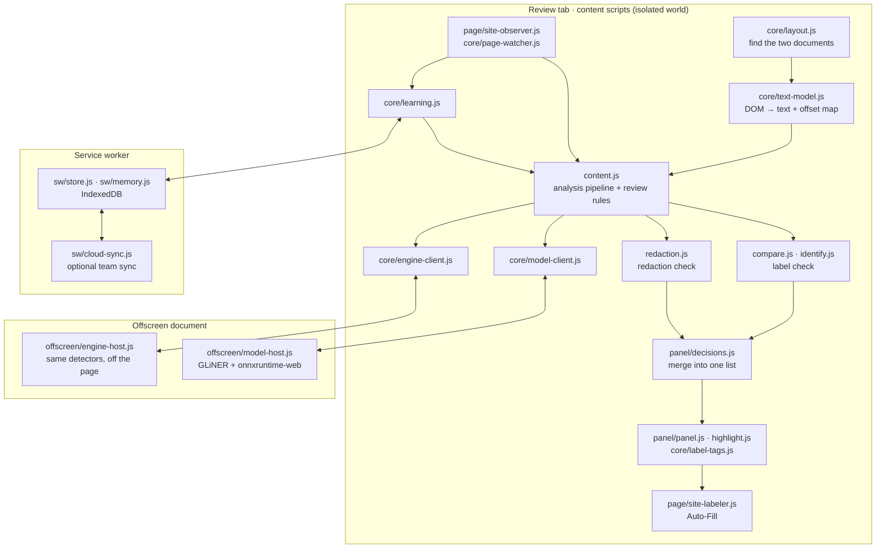
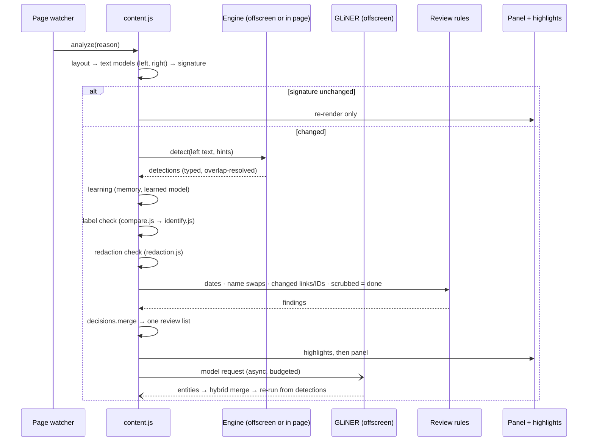

# Architecture

This document describes how PII Review Automation is built:
- the processes it runs in
- the analysis pipeline, from page to review list
- the data each stage produces
- the design choices behind its privacy and performance

## 1. Overview

The extension is a Chrome Manifest V3 extension with no build step and no runtime dependencies other than onnxruntime-web, which is vendored. It runs in four contexts:

| Context | Files | Responsibility |
|---|---|---|
| **Content scripts** (isolated world of the review page) | `manifest.json` → `content_scripts` (81 classic scripts) | Reads the documents, runs the analysis, renders the panel and highlights, drives Auto-Fill |
| **Offscreen document** (extension origin, hidden) | `offscreen/` | Hosts the detection engine for large documents and the GLiNER model (onnxruntime-web, WASM, multi-threaded) |
| **Service worker** (extension origin) | `background.js`, `sw/` | Opens the offscreen page, owns IndexedDB (learning memory), runs optional team sync |
| **Options page** | `options/` | Model, highlights and team-sync settings |

## 2. Module system

- All page-side code is plain ES2020 in classic scripts. Each file is an IIFE that attaches to one namespace object, `globalThis.PIIRA` (aliased `P`, created by `core/namespace.js`). Load order is the order in `manifest.json`: data, then helpers, detectors, engine, analysis, UI, and finally `content.js`.
- Content scripts run in Chrome's isolated world, so the review site's scripts cannot read or change `PIIRA`.
- Detectors, the engine, `compare.js`, `redaction.js`, `panel/decisions.js` and `core/hybrid.js` are **pure**: no DOM access. The same files load in Node for unit tests and in the offscreen page.
- The offscreen page loads the detector chain by reading `manifest.json` and injecting every content script up to `core/engine.js`, so both contexts always run identical rules.

## 3. The analysis pipeline

`content.js` runs one analysis per document version. A run is started by the page watcher (new task, re-render, label change), by a panel action, or by a model result arriving.

### 3.1 Finding the documents: `core/layout.js`

The two task documents are found by the first source that works:
1. a setup the reviewer saved for this site (**Set up manually**, `panel/picker.js`)
2. the organisation's policy (`pageSetup` in `managed_schema.json`)
3. the selectors in `selectors.js`
4. automatic detection (`core/autodetect.js`): two side-by-side elements with mostly the same words, plus how labels are marked inside the right one

### 3.2 Text model: `core/text-model.js`

Each document container becomes plain text plus a map from every character back to its DOM text node and offset. All later stages work on character offsets. Highlights, scrolling and selections convert offsets back to DOM `Range`s through the map. The page itself is never modified.

### 3.3 Detection: `core/engine.js`

1. **Context.** The task's file name (`core/pii-keys.js`, e.g. `by-pii-type~~kartu_keluarga~~…`), the project (`core/projects.js`) and the document's field structure (`core/structured.js`: CSV headers, JSON keys, `Key:` labels).
2. **Detectors.** Every registered detector (`detectors/*.js`) returns `{start, end, text, label: <type>, confidence, source, rule}`. Detectors combine shape regexes, checksums (Luhn, Verhoeff, mod-97, GSTIN, CPF/CNPJ), keyword proximity and field names.
3. **Context refinement.** Table headings and field labels confirm, retype or recover values (`core/table-context.js`), and pinned spans keep their exact boundaries.
4. **Knowledge.** Well-known public names (`core/known-names.js`, `core/knowledge.js`: Wikidata-derived companies and people, Tranco top domains) are marked as not PII.
5. **Overlap resolution.** Same-span duplicates are removed. Overlaps go to the longer span, then the more specific type (`P.SPECIFICITY` in `core/labels.js`).
6. **Labeling.** `type` keeps the specific type and `label` becomes the site label for the active label set (`P.labelOfType`).
7. **Never-PII filters.** Placeholders, dummy values, record IDs under `…_id` keys (account and transaction IDs excepted), service mailboxes, departments, and pieces of private IP addresses are dropped.

`core/engine-client.js` runs this in the offscreen page (`offscreen/engine-host.js`) and falls back to the page. `runAsync` yields to the event loop every ~25 ms. Results are cached by document hash, settings and knowledge versions.

### 3.4 On-device model: `offscreen/`, `core/hybrid.js`

- **Model.** GLiNER (mDeBERTa-v3 base, multi-PII), int8 ONNX, executed by onnxruntime-web in the offscreen document. Threads: `min(4, cores/2)` when cross-origin isolated (COOP/COEP headers in the manifest).
- **Tokenizer and decoding** are re-implemented in `offscreen/gliner-core.js`: SentencePiece Unigram, prompt construction, span decoding.
- **Prompts** (`offscreen/prompts.js`) ask only for names, companies, addresses and usernames, the types rules can't pin down.
- **Merge** (`core/hybrid.js`): rules own every fixed-shape type. When the model agrees, it raises confidence. A model-only entity above the `add` threshold is reported, and below it is shown as "possible". Code-like spans, roles and never-PII values are dropped.
- **Budget.** Long documents are processed in windows within a time budget. Partial results are merged as they arrive. The model frees its memory after 15 idle minutes.

The model is optional. Without the weights the status shows *not installed* and the rules work alone.

### 3.5 Label check: `compare.js`, `identify.js`

- `compare.js` aligns the two texts word by word (incremental, cached per document pair). It reads the labels on the right (`P.compare.readLabels`, using the label pattern from the layout) and maps each to the left. It then compares labels with detections: **missed**, **wrong label**, **over-scrub** (labeled but out of scope or a known public name), **needs review**, **correct**.
- `identify.js` turns that into review-list findings grouped as *Personal PII*, *Business PII*, *Credentials*, *Not PII*, *Check* and *Labeled ✓*.

### 3.6 Redaction check: `redaction.js`, `core/redaction-rules.js`

Every aligned change between left and right is classified:

| Category | Meaning |
|---|---|
| `LEAKAGE` | PII on the left appears unchanged on the right |
| `REDACTED_OK` | PII replaced with a realistic value of the same kind |
| `DATATYPE` | replaced with a value of a different kind (an email became a name) |
| `NOT_SENSIBLE` / `INCOHERENT` | replaced with filler (`XXXX`, `[NAME]`, random letters) |
| `OVER_REDACTED` | text that is not PII was replaced |
| `UNSURE` / `UNKNOWN_TEXT` | same shape, no PII type recognised |
| `TASK` | document-level notes (other language, unstructured text) |

### 3.7 Review rules: `content.js`

Project rules applied after both checks, in order:

1. **Dates.** A changed date, month or year is `OVER_REDACTED` unless it is a date of birth. A changed DOB is `REDACTED_OK`.
2. **Name swaps.** A capitalised dictionary name replaced by another name is `REDACTED_OK`, even when the name was too weak to detect on its own.
3. **Changed links.** A URL leak whose full link on the right differs from the original is `REDACTED_OK`.
4. **Changed prefixed IDs.** A leak whose full right-side token is another valid value of the same type (`card_1Nq…` → `card_7Pb…`) is `REDACTED_OK`.
5. **Not really over-scrubbed.** Digit-for-digit swaps, scrubbed links, short tokens and name lists in name fields are dropped from `OVER_REDACTED`.
6. **Scrubbed is done.** Any PII the right side already replaced (badly or not) becomes `REDACTED_OK`. No mark and no label suggestion.

### 3.8 One review list: `panel/decisions.js`

`P.decisions.merge(labelCheck, redactionCheck)` builds the list the reviewer sees:
- A label on the site wins over the redaction check.
- The redaction check wins over an unlabeled detection.
- Overlaps are resolved with a `Uint8Array` occupancy map.

Each finding keeps the question of the check it came from (`own(f)`) and its `settled` state. `decisions.js` also defines the sections, the per-category questions, and what each answer means for learning (`learnPlan`).

## 4. Acting on the site

### 4.1 Auto-Fill: `content.js` → `page/site-labeler.js`

`collectAutoFillTargets()` builds one target per word, because the site labels one word per label:
- **Sources:** redaction-check findings first, then label-check findings, then any detection still visible on the right.
- **Occupancy bits** stop overlaps: 1 = existing label, 2 = queued, 4 = partly scrubbed link.
- **Public links are never targets:** placeholders, whitelisted links and image files.

For each target, `applySingleAnnotation(range, label, tickMatching)` does what a person does:
1. Select the text.
2. Wait for the site's *Choose a label* dialog.
3. Pick the exact label.
4. Set *Annotate matching entries*.
5. Press Apply and wait for the dialog to close.

The hover card's **Auto-Apply** labels every word of one value and ticks *Annotate matching entries*. The main Auto-Fill leaves it unticked. A group's **Fill N** filters targets to that group. Submit is never touched.

### 4.2 Watching the page: `core/page-watcher.js`, `page/site-observer.js`

- **Page watcher.** A debounced `MutationObserver` re-runs the analysis on new tasks and label changes. Style, hover, focus and `aria-*` attribute churn is ignored. A content signature skips analysis when nothing changed.
- **Site observer.** Turns the reviewer's own label edits into answers for the learning layer: label added, changed, removed, or *Overscrubbed* added.

## 5. Learning: `core/learning.js`

Three layers, strongest first:

1. **Value memory.** A value the reviewer judged gets the same answer in every later document: dropped, relabeled, or added where detectors missed it. Values are stored as two 32-bit FNV-1a hashes.
2. **Learned model.** A multinomial logistic regression over hashed features: value shape, character trigrams, detector, field name, nearby words. It only acts with enough examples and high confidence. It never deletes a detection: a "not PII" guess only lowers confidence.
3. **Detectors and GLiNER**, unchanged.

Storage is IndexedDB in the extension's origin (`sw/store.js`, `sw/memory.js`), never the review site's. Tabs are notified of writes through `chrome.storage`. Optional team lists sit below the reviewer's own answers ([CLOUD.md](CLOUD.md)).

## 6. User interface

| Component | File | Notes |
|---|---|---|
| Review panel | `panel/panel.js`, `panel/panel-styles.js` | Closed Shadow DOM (open in test mode), frosted-glass theme with light and dark modes. Grouped list, Prev/Next, filters, Add sheet, per-group Fill/Redact all/Keep all, learning and setup sections, release chip in the footer |
| Launcher | `panel/panel.js` | **PII** count button and **Auto-Fill PII** button, draggable as one group |
| Highlights | `highlight.js`, `highlight.css` | CSS Custom Highlight API: one highlight per label, wavy underline on the right, solid on the left. Painted only for the visible window |
| Label tags | `core/label-tags.js` | Label pills above detected values on the left, in a fixed overlay layer |
| Hover card | `content.js` | "Mark with: <label>", the original value, the reason, and **Auto-Apply** |
| Select-to-check | `core/select-check.js` | Card under any selection: PII or not, and why |
| Click setup | `panel/picker.js` | Point at left, right and one label. Clicks are captured and never reach the site |

## 7. Performance design

- **Off-page detection.** Detection runs in the offscreen document, and `runAsync` yields every ~25 ms on the in-page fallback.
- **Caching.** Results are cached at every stage: detections by content hash, word alignment per document pair, link sets per document, Public Suffix lookups (memoised, capped), Auto-Fill targets keyed by result and answer version.
- **Linear overlap checks.** `Uint8Array` occupancy maps keep overlap checks linear on documents with thousands of findings.
- **Paced rendering.** Highlights first, then the panel, with `await pause()` between stages. Only the visible part of long documents gets highlights and tags.
- **Quiet watcher.** The watcher ignores attribute churn that doesn't change content.
- **Model limits.** At most `min(4, cores/2)` model threads, so the review site stays responsive.

## 8. Configuration surfaces

| Surface | Scope | Where |
|---|---|---|
| `selectors.js` | Site markup | Source |
| Enterprise policy | Organisation | `managed_schema.json` → `core/policy.js` |
| Options page | Reviewer | `options/` → `chrome.storage.local` |
| Panel settings | Reviewer, per task | Label set, project, highlights, learning reset |
| `P.SETTINGS` | Code defaults | `core/labels.js`, `core/hybrid.js` |

Details are in [DEPLOYMENT.md](DEPLOYMENT.md).

## 9. Not included in this repository

- **Model weights.** `models/multi_pii/onnx/model_int8.onnx` (~350 MB) exceeds GitHub's file limit. See [models/README.md](../models/README.md).
- **Team-sync server.** Referred to as `../piira-cloud`; it's a separate FastAPI service. The protocol is in [CLOUD.md](CLOUD.md).
- **Offline build and evaluation scripts.** Referred to in comments (`scripts/build-names.js`, `npm run build-kb`, `ml/eval.js`). Their outputs (`data/names.js`, `data/kb/`) are committed.
